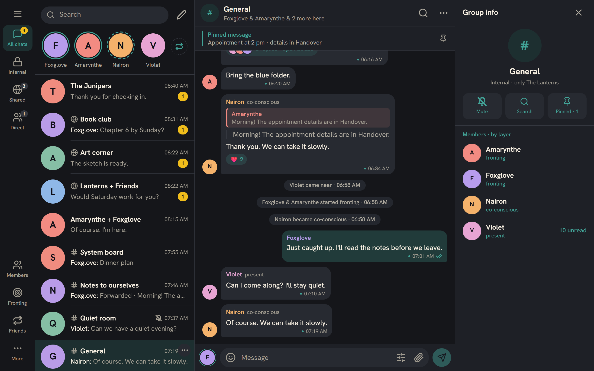
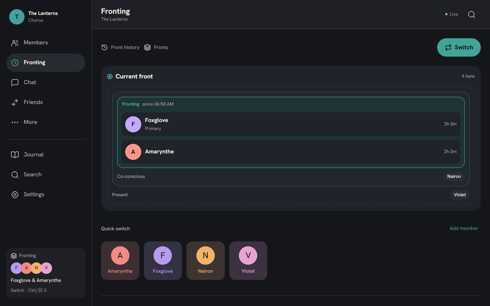
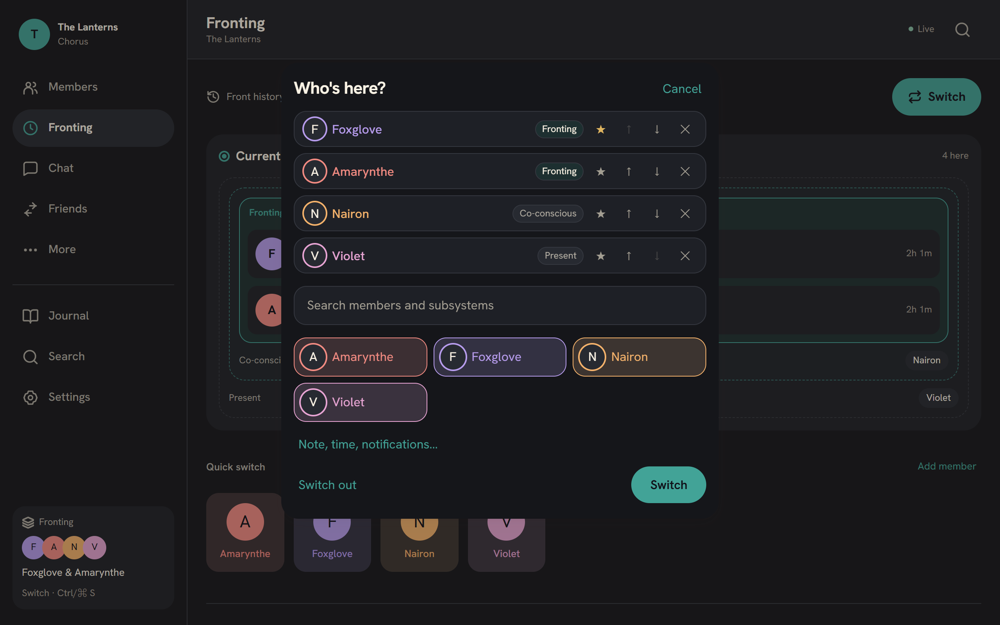
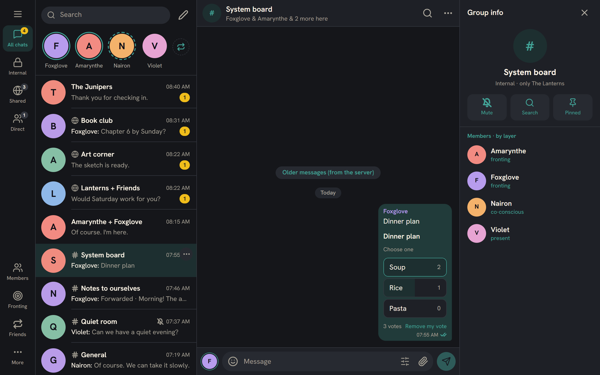
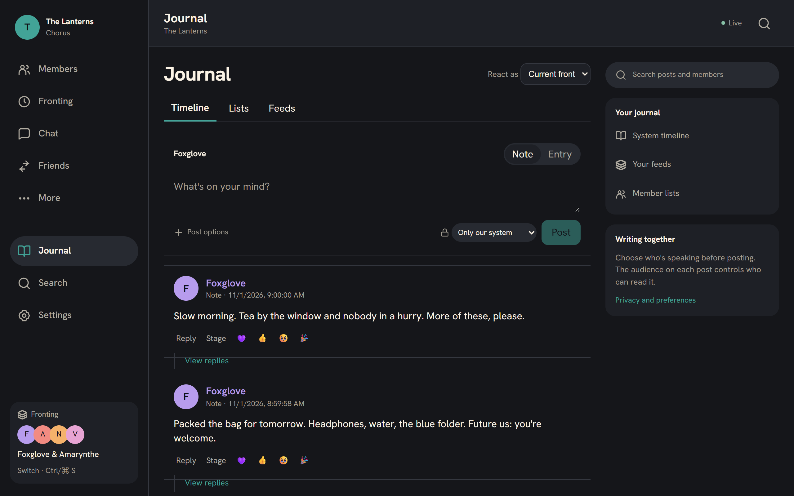
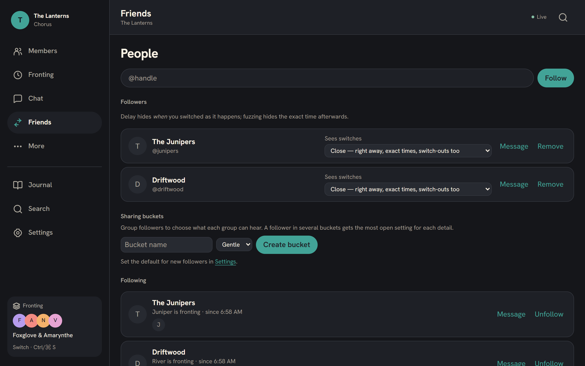
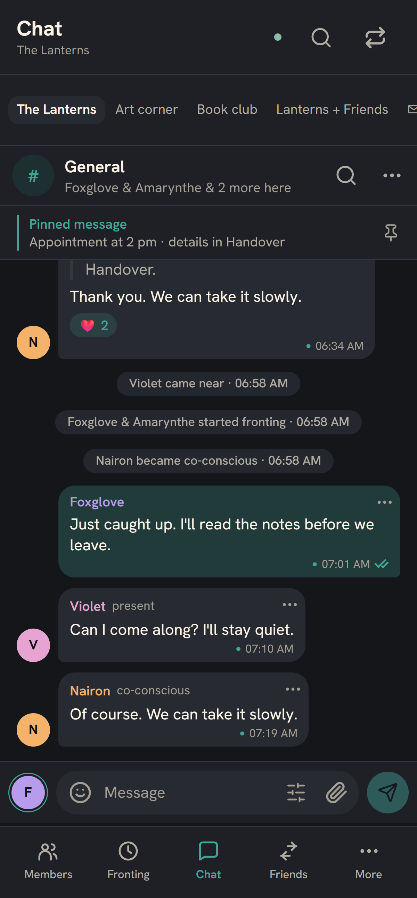
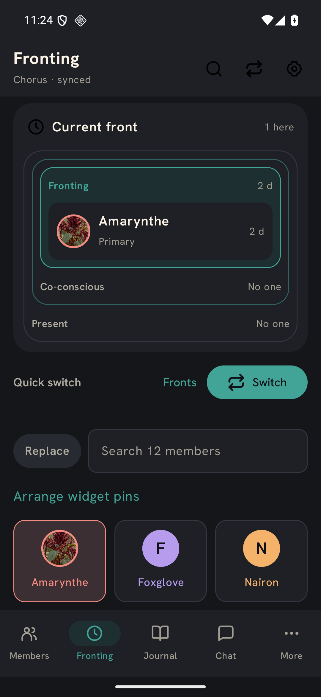

# Chorus

A home for plural systems and the people close to them. Keep track of who's fronting, talk as
your members, write in a shared journal, and let friends know who's around, on your terms.

It runs on a server you control. Nobody else has your data.



> **Status:** usable and in daily use, still changing fast. The web app is the most complete;
> the Android app is being polished. There are no downloadable releases yet.

## What it does today

**Fronting.** See who's fronting, co-conscious or just nearby, and switch in a couple of taps.
Front history lets you look back, fix a switch you forgot, or log one after the fact. Insights
show patterns over time.

 

**Chat.** Channels and private chats inside your system, where every message is sent as one or
more members. Replies, quotes, threads, reactions, pins, polls, images, custom emoji, spoilers,
and search. Private chats between members only show up while one of them is around.



**Journal.** Short notes and longer entries, written by whoever's fronting. Each post has its
own audience: just your system, your followers, or everyone on the server.



**Friends.** Follow other systems and singlets on the same server, chat with them in shared
spaces and DMs, and choose how much each of them hears about your switches: right away, later
and roughly, or once a day.



**Stage mode.** Share a conversation or post as a screenshot with only the messages you pick.
Hide names, blur avatars, choose a style.

**On your phone.** An Android app with a quick-switch home-screen widget and notifications. On
anything else the web app installs like an app. Both work offline and catch up when they're
back online.

 

**Your data.** Export everything at any time. Import from PluralKit.

## Planned

- A smoother Android app: chat and journal that feel as good as the apps you already use.
- Named fronts: several fronts tracked side by side, each with its own people, and a say in
  who signs your messages.
- Chorus Home: a one-click installer for a Windows PC, so a system can run Chorus on their home
  wifi without touching a terminal.
- PluralSpec, an open file format for moving between plural apps (Simply Plural, PluralKit and
  others).
- Voice and video messages, link previews, and stage screenshots saved straight to an image.

No iOS app is planned. On an iPhone, add the web app to your home screen.

## Run your own

You need a small Linux server (Debian 12+ or Ubuntu 22.04+), a domain pointing at it, and a
Windows PC to build on (Rust, Node, and Docker in WSL). A prebuilt download is not available yet.

1. Build the bundle on the PC:

   ```powershell
   pwsh scripts/pack-linux.ps1 -Out C:\chorus-build
   ```

2. Copy it to the server, unpack it and install:

   ```sh
   tar xzf chorus-linux-*.tar.gz && cd chorus
   sudo bash install.sh --domain chorus.example.org --email you@example.org
   ```

3. It prints your first invite link. Open it on your phone or in a browser.

Chorus has no sign-up page; everyone joins through an invite. To make more:

```sh
sudo -u chorus /opt/chorus/app/chorus-server --config /etc/chorus/chorus.toml invite --kind system   # or --kind person
```

Updates are the same steps with a newer bundle. Your data and settings stay put. For running it
on a Windows PC over Tailscale, moving servers, backups and the rest, see
[Operations](docs/OPS.md) and [deploy/linux/README.txt](deploy/linux/README.txt).

## Documentation

[Product spec](docs/SPEC.md) · [Decisions](docs/DECISIONS.md) · [Data model](docs/DATA_MODEL.md) ·
[Sync](docs/SYNC.md) · [Notifications](docs/NOTIFICATIONS.md) · [API](docs/API.md) ·
[Design](docs/DESIGN.md) · [Clients](docs/CLIENTS.md) · [Operations](docs/OPS.md) ·
[Progress](PROGRESS.md)

## License

MIT. See [LICENSE](LICENSE).

The PluralSpec data format in [`spec/`](spec/) is licensed separately: its schema and examples
under CC BY 4.0, its text under CC BY-NC-SA 4.0 (see [spec/LICENSE](spec/LICENSE)).
